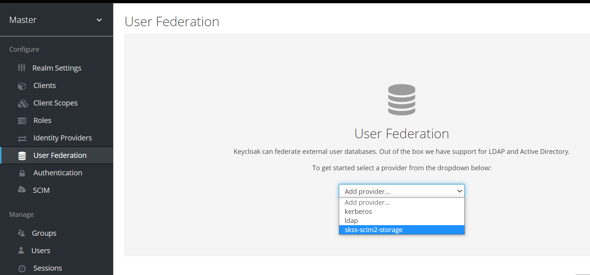
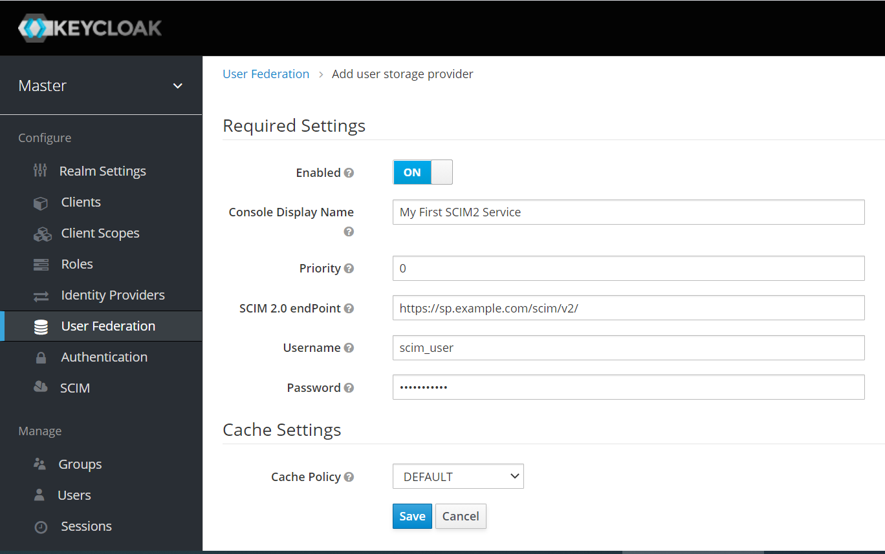
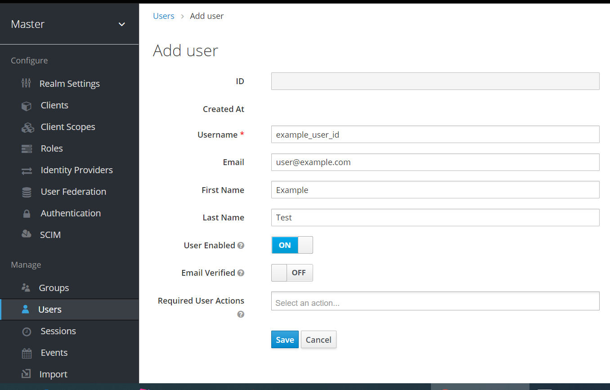

# Keycloak SCIM 2.0 outbound user provisioning

A [Keycloak](https://www.keycloak.org/) extension that provisions users, groups and
role memberships from Keycloak to an external SCIM 2.0 service provider. It plugs into
Keycloak as a User Federation provider plus an event listener, and pushes changes to
the SCIM server through a job queue with retries.

## Supported Keycloak versions

| Keycloak | Jar |
|---|---|
| 26.5.6 | `scim2-provisioning-keycloak-26.5.6-jar-with-dependencies.jar` |
| 26.2.5 | `scim2-provisioning-keycloak-26.2.5-jar-with-dependencies.jar` |
| 24.0.4 | `scim2-provisioning-keycloak-24.0.4-jar-with-dependencies.jar` |

Use the jar built for your Keycloak version. The list of supported versions lives in
[`.github/workflows/build.yml`](.github/workflows/build.yml); CI builds and tests every one.

## Installation

> **Back up the Keycloak database first.** On its first start with the extension, Keycloak
> creates the extension's tables (`SCIM_SYNC_JOB_QUEUE` and `FED_GROUP_ATTRIBUTE`) through
> Liquibase.

1. Download the jar for your Keycloak version from
   [GitHub Releases](https://github.com/adactafintech/keycloak-scim2-storage/releases/latest).
2. Copy it to the Keycloak providers directory:

   ```bash
   cp scim2-provisioning-keycloak-26.5.6-jar-with-dependencies.jar /opt/keycloak/providers/
   ```

3. Rebuild Keycloak and restart it:

   ```bash
   /opt/keycloak/bin/kc.sh build
   # then restart Keycloak as you normally do, e.g.
   /opt/keycloak/bin/kc.sh start
   ```

To upgrade, replace the jar in `providers/` with the new one and repeat step 3.

## Configuration

1. In the admin console, open the realm, go to **User federation** and add the
   **skss-scim2-storage** provider.

   

2. Fill in the settings and save.

   

   The screenshots are from the older admin console. Today's form has these settings:

   | Setting | Required | Description |
   |---|---|---|
   | SCIM 2.0 url | yes | Base URL of the SCIM 2.0 server. |
   | Authority url | yes | OpenID Connect realm (issuer) URL of the authority that protects the SCIM server; the token is requested from `<Authority url>/protocol/openid-connect/token`. |
   | Client Id | yes | Client used to get the token. |
   | Client Secret | | Secret of that client, if it is confidential. |
   | Username, Password | | When both are set, the token is requested with the password grant; otherwise with client credentials. |
   | Trust any TLS certificate | | Off by default. See [TLS certificates](#tls-certificates-of-the-scim-server). |
   | Connect timeout (seconds) | | Default 10. See [Timeouts](#timeouts). |
   | Request timeout (seconds) | | Default 100. See [Timeouts](#timeouts). |

3. To push changes made in Keycloak as they happen, add `scim-event-listener` under
   **Realm settings → Events → Event listeners**.

4. Create a user (or change one): it is provisioned to the SCIM server.

   

Existing users can be pushed with the provider's **Sync all users** and **Sync changed
users** actions.

### TLS certificates of the SCIM server

The SCIM server's TLS certificate and host name are verified against Keycloak's
truststore. If your SCIM server uses a self-signed or private-CA certificate, add
it to the Keycloak truststore (see the Keycloak "Configuring trusted certificates"
guide).

For test setups only, the provider setting **Trust any TLS certificate** turns off
certificate and host name verification for the SCIM url. It is off by default.
Versions before this setting existed always skipped verification, so after
upgrading, providers that talk to a self-signed SCIM server need one of the two
options above.

### Timeouts

Two provider settings limit how long Keycloak waits for the SCIM server, in seconds:

- **Connect timeout** (default 10): establishing the connection.
- **Request timeout** (default 100): waiting for the answer to each SCIM request.

Leave a field empty to use the default.

### Is your SCIM server compliant with SCIM 2.0?

You can test the compliance level with
[scim2-compliance-test-utility](https://github.com/suvera/scim2-compliance-test-utility).

## Building locally

Requirements: JDK 17 and Maven. The integration tests also need Docker (or a
Docker-compatible engine such as Podman), because they start a real Keycloak in a container.

```bash
# Build the jar for one Keycloak version (tests are skipped by default)
mvn clean package -Dkeycloak.version=26.5.6
# -> target/scim2-provisioning-keycloak-26.5.6-jar-with-dependencies.jar

# Build and run all tests, including the integration tests, against that version
mvn clean verify -Dkeycloak.version=26.5.6 -P run-integration-tests

# Run a single test class
mvn verify -Dkeycloak.version=26.5.6 -P run-integration-tests -Dtest=UserSyncTests
```

Without `-Dkeycloak.version`, the build uses the default from `pom.xml` (26.5.6).

## Releases

A release is published when a merge to `master` changes the version in `pom.xml`
to one that is not tagged yet. The release has one jar per supported Keycloak version.
Pull requests show a "Release preview" check that says whether merging will publish one.

## Origin

This project derives from
[suvera/keycloak-scim2-storage](https://github.com/suvera/keycloak-scim2-storage).
